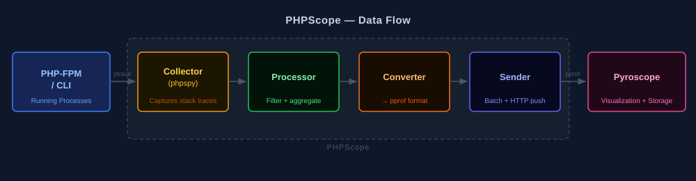

# PHPScope

[](https://vshymanskyy.github.io/StandWithUkraine/)

PHPScope is a PHP profiling tool based on [phpspy](https://github.com/adsr/phpspy) that integrates with Pyroscope to provide continuous profiling for PHP applications. It captures through [phpspy](https://github.com/adsr/phpspy) PHP-FPM and PHP CLI processes performance data and sends it to a Pyroscope server for visualization and analysis.

## Features

- Real-time PHP process profiling
- Integration with Pyroscope
- Configurable sampling rate and batch processing
- Support for PHP-FPM and PHP CLI processes
- Customizable tags for better data organization
- Function exclusion patterns
- Concurrent processing support ( WIP )

## Architecture



The diagram above shows the main components of PHPScope:

1. **Collector (phpspy)**: Captures stack traces from PHP processes
2. **Processor**: Processes and filters the raw stack traces
3. **Converter**: Converts traces to Pyroscope-compatible format
4. **Sender**: Handles communication with Pyroscope server

## Prerequisites

- Go 1.27.3 or higher
- PHP-FPM or PHP CLI processes running ( Tested on PHP 8.3 )
- Access to a Pyroscope server
- phpspy installed on the system ( Included in docker container )

## Installation

You can either run PHPScope using Docker Compose or build it from source.

### Using Docker Compose

   ```shell
   curl -sSL https://raw.githubusercontent.com/everythings-gonna-be-alright/phpScope/refs/heads/main/examples/docker-compose/docker-compose.yaml | docker compose -f - up -d
   ```

Once running, PHPScope will automatically discover and profile all PHP processes (PHP-FPM and PHP CLI) running on the host — including those inside Docker containers — and continuously stream profiling data to the bundled Pyroscope instance.

After installation, you can access the Pyroscope UI at:

   ```shell
   http://127.0.0.1:4040
   ```

To run the example with phpScope built from your local checkout instead of the published image:

   ```shell
   cd examples/docker-compose
   docker compose -f docker-compose.yaml -f docker-compose.build.yaml up -d --build
   ```

### Deploying on Kubernetes (Helm)

For Kubernetes environments, the recommended approach is to run PHPScope as a **sidecar container** alongside your PHP application pod. This gives PHPScope direct access to the PHP processes within the same pod namespace without requiring host-level privileges beyond the pod boundary.

A Helm chart example is available in [`examples/helm-chart/wordpress-example`](examples/helm-chart/wordpress-example). It includes a full deployment with PHPScope as a sidecar, Pyroscope as a subchart dependency, NetworkPolicy, and all required RBAC resources.

   ```shell
   git clone https://github.com/everythings-gonna-be-alright/phpScope
   cd phpScope/

   # Install into your cluster
   helm upgrade --install wordpress-example examples/helm-chart/wordpress-example/ \
     --namespace wordpress-example \
     --create-namespace
   ```

Once installed, use port-forwarding to access the services locally:

   ```shell
   # Pyroscope UI
   kubectl port-forward -n wordpress-example svc/wordpress-example-pyroscope 4040:4040

   # WordPress
   kubectl port-forward -n wordpress-example svc/wordpress-example 8080:8080
   ```

Then open:
- Pyroscope UI: `http://localhost:4040`
- WordPress: `http://localhost:8080`

### Building from Source

   ```shell
   git clone https://github.com/everythings-gonna-be-alright/phpscope
   cd phpscope
   go build
   ```

## Security recommendations

### Run without root

The Helm example runs PHPScope as non-root (UID/GID 33, the same as PHP-FPM's `www-data`) with every capability dropped, a read-only root filesystem, `allowPrivilegeEscalation: false` and the default seccomp profile. phpspy can attach to processes of the same user, so neither root nor `SYS_PTRACE` is needed. The e2e suite runs this configuration and verifies that every request is profiled.

This depends on the node kernel. With `kernel.yama.ptrace_scope` of 1 or higher (the Ubuntu default) a process may only trace its own descendants, so the same-UID sidecar is denied. Either set `ptrace_scope` to 0 on those nodes, or run PHPScope as root with only the `SYS_PTRACE` capability:

   ```yaml
   phpscope:
     securityContext:
       runAsNonRoot: false
       runAsUser: 0
       capabilities:
         drop: [ALL]
         add: [SYS_PTRACE]
   ```

If your PHP image does not use UID 33, set `runAsUser` and `runAsGroup` to its UID and GID. The Docker Compose example profiles processes of other containers and host processes, so it keeps `SYS_PTRACE` and runs as root.

### Verify downloads

Every release publishes a `SHA256SUMS` file next to the binaries. Check the binary before running it:

   ```shell
   VERSION=v0.1.4
   BASE=https://github.com/everythings-gonna-be-alright/phpScope/releases/download/$VERSION
   curl -fsSLO $BASE/app-linux-amd64
   curl -fsSLO $BASE/SHA256SUMS
   sha256sum --check --ignore-missing SHA256SUMS   # macOS: shasum -a 256 --check --ignore-missing SHA256SUMS
   ```

### Mirror images for production

For critical production, do not pull `hiload/phpscope` straight from Docker Hub. Copy a released version to your own registry, pin it by digest, and scan it with your usual tools:

   ```shell
   crane copy docker.io/hiload/phpscope:v0.1.4 registry.example.com/mirror/phpscope:v0.1.4
   crane digest registry.example.com/mirror/phpscope:v0.1.4
   ```

`crane copy` keeps the multi-platform manifest. Reference the image as `registry.example.com/mirror/phpscope:v0.1.4@sha256:<digest>` so Kubernetes pulls exactly the image you reviewed. The same applies to the Pyroscope and PHP images used next to it.

## Usage

Basic usage example:

   ```shell
   ./phpscope --pyroscopeUrl="http://pyroscope:4040" --appName="your-app-name"
   ```

### Command Line Options

| Option              | Default                   | Description                                       |
|---------------------|---------------------------|---------------------------------------------------|
| --pyroscopeUrl      | required                  | URL of the Pyroscope server                       |
| --auth              | ""                        | Pyroscope authentication token. Falls back to the `PHPSCOPE_AUTH_TOKEN` environment variable, which is preferred because command line arguments are visible in the process list |
| --appName           | required                  | Application name for profiling                    |
| --rateHz            | 400                       | Sample rate in Hz                                 |
| --interval          | 0.1                       | Maximum time between requests to Pyroscope server |
| --batch             | 50000                     | Maximum number of traces in request               |
| --concurrent        | 1                         | Concurrent request limit                          |
| --exclude           | ""                        | Regex pattern to exclude functions                |
| --tags              | []                        | Tags in format key=value                          |
| --phpspyBufferSize  | 131072                    | phpspy buffer size                                |
| --phpspyMaxDepth    | -1                        | phpspy max stack depth (-1 = unlimited)           |
| --phpspyThreads     | 64                        | phpspy threads count                              |
| --phpspyRequestInfo | pu                        | Request info phpspy captures (q=query string, c=cookie, u=uri, p=path) |
| --sampleLabels      | path,uri                  | Comma-separated trace fields sent as per-sample labels (`uri`, `path`, `qstring`, `cookie`, `ts`, `mem`) |
| --pgrep             | `-x "(php-fpm.*\|^php$)"` | pgrep pattern for finding PHP processes           |
| --debug             | false                     | Enable debug logging                              |

### Sample labels

Labels let you filter and group profiles in Pyroscope. With the defaults, select the application, then add `{uri="/wp-login.php"}` to the query or group by `uri`. Note that `uri` is the script URL (`/index.php`), not the routed page, so frameworks with a front controller show a single value.

Each distinct value of a sample label becomes a separate Pyroscope series, and Pyroscope rejects profiles (HTTP 422) once its active series limit is reached. `ts` (the request start time) is unique per request, so enabling it makes the series count grow with traffic and stops profiles from merging across requests. Use it only for short debugging sessions or to isolate a single request, for example `--sampleLabels=path,uri,ts`. `uri` and `qstring` can be high-cardinality too. The examples raise the limit to 50,000 (`-ingester.max-global-series-per-tenant`, default 5,000); size it for your traffic. `cookie` and `qstring` can also carry session tokens and other secrets into Pyroscope, so only enable them for short debugging sessions, together with the matching `--phpspyRequestInfo` letter.

## Example

Profile a PHP application with custom tags and exclusion pattern:

   ```shell
   ./phpscope \
     --pyroscopeUrl="http://pyroscope:4040" \
     --appName="my-php-app" \
     --tags="environment=production" \
     --tags="version=1.0" \
     --exclude="vendor/*" \
     --rateHz=100
   ```

## Testing

Unit tests:

   ```shell
   go test -race ./...
   ```

End-to-end tests build the phpScope image, start a [kind](https://kind.sigs.k8s.io/) cluster, install the WordPress Helm example, generate traffic and verify that the profiles reach Pyroscope with the expected tags, PHP stacks and no errors. They require Docker, kind and Helm, and use a temporary kubeconfig, so your `~/.kube/config` and current kubectl context are not touched. To inspect a kept cluster, use `kubectl --kubeconfig <(kind get kubeconfig --name phpscope-test)`.

   ```shell
   cd e2e
   go test -tags e2e -count=1 -v -timeout 30m ./...
   ```

Use `-count=1` so Go does not replay a cached result. To open WordPress and Pyroscope from a kept cluster, run with `E2E_KEEP_CLUSTER=1`, then:

   ```shell
   kind get kubeconfig --name phpscope-test > /tmp/phpscope-test.kubeconfig
   export KUBECONFIG=/tmp/phpscope-test.kubeconfig
   kubectl -n phpscope-e2e port-forward svc/wp-pyroscope 4040:4040
   kubectl -n phpscope-e2e port-forward svc/wp-wordpress-example 8080:8080
   ```

| Variable           | Default         | Description                                        |
|--------------------|-----------------|----------------------------------------------------|
| `E2E_CLUSTER_NAME` | `phpscope-test` | kind cluster name (an existing cluster is reused)  |
| `E2E_KEEP_CLUSTER` | unset           | Set to `1` to keep the cluster after the run       |
| `E2E_LOGS_DIR`     | unset           | Directory to export cluster logs to after the run  |

## Contributing

Contributions are welcome! Please feel free to submit a Pull Request.

## License

This project is licensed under the MIT License - see the LICENSE file for details.
